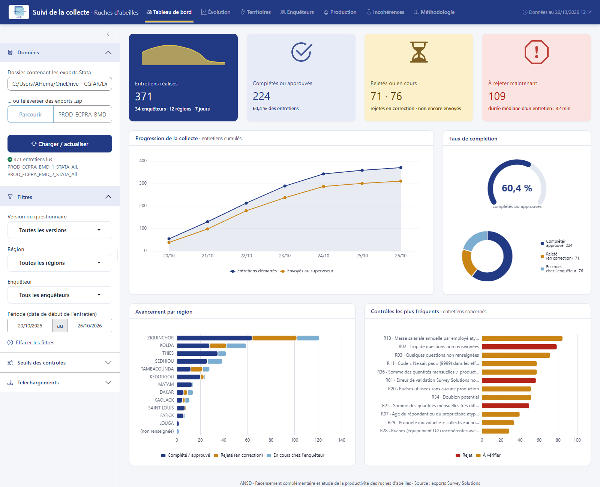
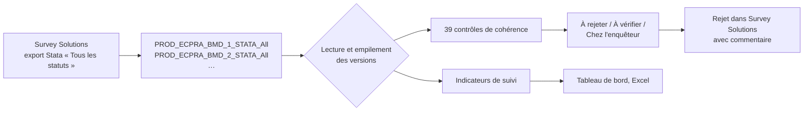

# Suivi de la collecte et contrôle de cohérence : ruches d'abeilles (ANSD)


Outils de supervision de l'enquête **« Recensement complémentaire et étude de la productivité des ruches d'abeilles »** de l'Agence nationale de la statistique et de la démographie du Sénégal (ANSD). La collecte se fait sur tablette avec Survey Solutions.

À partir des exports Stata de Survey Solutions, qui peuvent couvrir plusieurs versions du questionnaire, le projet :

1. **suit l'avancement de la collecte** : par jour, par région, par département et par enquêteur, avec les durées et les taux de rejet ;
2. **détecte les incohérences** grâce à 39 contrôles, et produit la **liste des entretiens à rejeter** dans Survey Solutions, avec un commentaire de rejet prêt à coller.

Deux outils donnent **exactement les mêmes résultats**, pour deux usages :

| Outil | Pour qui | Résultat |
|---|---|---|
| [`application_shiny/`](application_shiny/) | Superviseurs, coordination | Application web interactive aux couleurs de l'ANSD : filtres, graphiques, seuils réglables, téléchargements |
| [`programmes/suivi_collecte.py`](programmes/suivi_collecte.py) | Traitement automatique, archivage | Deux classeurs Excel et un CSV de rejet, générés d'un double-clic |



---

## Fonctionnement



Chaque version du questionnaire déployée sur le serveur produit un export distinct. Les outils détectent automatiquement tous les dossiers `PROD_ECPRA_BMD_<n>_STATA_All`, en dossier ou en `.zip`, et les empilent. Une nouvelle version (V3, V4…) est donc prise en compte sans rien modifier.

## Structure du dépôt

```
.
├── application_shiny/            Application R Shiny
│   ├── app.R                     Interface et serveur
│   ├── R/
│   │   ├── lecture.R             Lecture des exports Stata (haven)
│   │   ├── controles.R           Contrôles R01 à R39, listes de rejet
│   │   ├── suivi.R               Tableaux de suivi de la collecte
│   │   ├── export_excel.R        Classeurs Excel téléchargeables
│   │   ├── interface.R           Charte ANSD, graphiques et tableaux
│   │   ├── diffusion.R           Version de diffusion (HTML autonome, agrégats seuls)
│   │   └── parametres.R          Seuils et catalogue des contrôles
│   ├── www/logo_ansd.png
│   ├── donnees/                  Dossier où déposer les exports (non versionné)
│   ├── installer_packages.R
│   ├── lancer_application.bat
│   └── LISEZMOI.txt
├── programmes/
│   └── suivi_collecte.py         Version Python (sorties Excel + CSV)
├── environment.yml               Environnement conda figé (Python)
├── lancer_suivi.bat              Lanceur de la version Python
├── LISEZMOI.txt                  Notice de la version Python
└── docs/                         Images de la documentation
```

> **Les données ne sont pas dans ce dépôt.** Les exports Survey Solutions contiennent des informations personnelles (noms, téléphones, localisation des apiculteurs), et les sorties contiennent des résultats nominatifs par enquêteur. Le fichier [`.gitignore`](.gitignore) les exclut. Ne retirez jamais ces exclusions.

---

## Démarrage rapide

### Application R Shiny

**Prérequis :** [R ≥ 4.3](https://cran.r-project.org/bin/windows/base/). RStudio est facultatif.

1. Déposer les exports Stata de Survey Solutions dans `application_shiny/donnees/`, sans les renommer. Ils peuvent rester en `.zip`.
2. Sous Windows, double-cliquer sur `application_shiny/lancer_application.bat`. Sinon :

   ```r
   setwd("application_shiny")
   source("installer_packages.R")   # installe les packages manquants (une fois)
   shiny::runApp(launch.browser = TRUE)
   ```

L'application contient sept onglets :

| Onglet | Contenu |
|---|---|
| Tableau de bord | Indicateurs clés, progression cumulée, taux de complétion, avancement par région, contrôles les plus fréquents |
| Évolution | Activité quotidienne, durée des entretiens |
| Territoires | Avancement par région et par département |
| Enquêteurs | Performance, calendrier enquêteur × jour, nuage durée / taux de rejet |
| Production | Premiers résultats 2025 : miel, cire, rendement, prix médian |
| Incohérences | À rejeter (bouton « Copier » du commentaire, détail dépliable), à vérifier, chez l'enquêteur, bilans |
| Méthodologie | Mode d'emploi, catalogue des contrôles avec les seuils en vigueur |

Le panneau latéral propose :
- des filtres par version, région, enquêteur et période ;
- les seuils des contrôles, réglables ;
- le téléchargement des classeurs Excel et du CSV de rejet.

#### Partager avec une personne extérieure

Le bouton **« Exporter la version de diffusion »** (panneau Téléchargements) produit un **fichier HTML autonome** d'environ 2 Mo. Il s'ouvre hors connexion dans tout navigateur et s'envoie par e-mail. Il ne contient que des agrégats :

- **aucune donnée individuelle** : ni clé d'entretien, ni commune, ni nom, ni commentaire. Un audit automatique le vérifie sur l'ensemble des identifiants de la base ;
- **enquêteurs anonymisés** : Enquêteur 01, 02…, sans région ;
- **secret statistique** : toute valeur portant sur moins de 3 unités (seuil réglable) est remplacée par « s ».

Le masquage est primaire : avant diffusion, vérifier qu'un total ne permet pas de retrouver une valeur masquée par différence.

Packages utilisés :
- **interface** : `bslib`, `bsicons`, `shinyWidgets`, `shinycssloaders`, `waiter` ;
- **graphiques** : `echarts4r` ;
- **tableaux** : `reactable` ;
- **données** : `haven`, `dplyr`, `tidyr`, `openxlsx`.

### Version Python

**Prérequis :** [Miniforge](https://conda-forge.org/download/) (ou Miniconda / Anaconda).

1. Déposer les exports `PROD_ECPRA_BMD_<n>_STATA_All` à la racine du projet.
2. Sous Windows, double-cliquer sur `lancer_suivi.bat`. Au premier lancement, il crée l'environnement `ruches-ansd`. Sinon :

   ```bash
   conda env create -f environment.yml
   conda activate ruches-ansd
   python programmes/suivi_collecte.py
   ```

Le dossier `sorties/` reçoit trois fichiers :

| Fichier | Contenu |
|---|---|
| `Suivi_collecte_<date>.xlsx` | Synthèse, évolution journalière, régions, départements, production, enquêteurs, enquêteur × jour |
| `Incoherences_a_rejeter_<date>.xlsx` | À rejeter, à vérifier, chez l'enquêteur, détail, synthèse par contrôle, bilan par enquêteur |
| `Liste_rejet_API_<date>.csv` | `interview__id` et commentaire, pour un rejet en masse par l'API Survey Solutions |

---

## Contrôles de cohérence

Les contrôles complètent les validations déjà codées dans le questionnaire. Survey Solutions laisse en effet l'enquêteur envoyer un entretien qui a encore des erreurs, et certaines incohérences entre sections n'y sont pas contrôlées. Chaque contrôle a un niveau :

- **Rejet** : incohérence bloquante ; l'entretien est renvoyé à l'enquêteur.
- **À vérifier** : valeur atypique ; le superviseur décide après vérification.

| Code | Niveau | Contrôle |
|---|---|---|
| R01 | Rejet | Erreur de validation Survey Solutions non corrigée |
| R02 | Rejet | Trop de questions non renseignées (≥ 5) |
| R03 | À vérifier | Quelques questions non renseignées (1 à 4) |
| R04 | Rejet | Durée d'entretien trop courte (< 10 min) |
| R05 | À vérifier | Durée d'entretien très longue (> 180 min) |
| R06 | Rejet | Localisation incomplète (région, département, commune, milieu) |
| R07 | À vérifier | Âge du répondant ou du propriétaire atypique |
| R08 | Rejet | Année de création hors bornes |
| R09 | À vérifier | Exploitation très ancienne (< 1960) |
| R10 | Rejet | Effectif total ≠ hommes + femmes |
| R11 | À vérifier | Code « ne sait pas » (9999) dans les effectifs ou salaires |
| R12 | À vérifier | Effectif du personnel élevé (> 100) |
| R13 | À vérifier | Masse salariale annuelle par employé atypique |
| R14 | Rejet | Aucune ruche déclarée, mais des ruches exploitées |
| R15 | À vérifier | Type de ruche exploité mais non déclaré possédé |
| R16 | Rejet | Ruches utilisées > ruches détenues |
| R17 | Rejet | Quantité vendue > quantité produite (miel ou cire) |
| R18 | Rejet | Vente sans montant, ou montant sans vente |
| R19 | Rejet | Production de miel sans ruche utilisée |
| R20 | À vérifier | Ruches utilisées sans aucune production |
| R21 | À vérifier | Rendement en miel très élevé (> 40 L / ruche) |
| R22 | Rejet | Prix du miel aberrant, erreur d'unité probable (hors 500 à 25 000 FCFA/L) |
| R23 | À vérifier | Prix du miel atypique (hors 1 000 à 15 000 FCFA/L) |
| R24 | À vérifier | Prix de la cire atypique |
| R25 | Rejet | Somme des quantités mensuelles très différente de la production annuelle (facteur > 2) |
| R26 | À vérifier | Mois de production déclarés sans aucune production |
| R27 | À vérifier | Forte variation du nombre de ruches entre 2024 et 2025 |
| R28 | À vérifier | Ruches en équipement (D.2) incohérentes avec les ruches détenues (C.1) |
| R29 | À vérifier | Propriété individuelle + collective ≠ nombre total |
| R30 | À vérifier | Prix d'achat d'un équipement ou d'une infrastructure très faible |
| R31 | À vérifier | Âge d'un équipement ou d'une infrastructure très élevé |
| R32 | À vérifier | Organisation (coopérative, GIE, association) avec moins de 2 membres |
| R33 | À vérifier | Dates incohérentes (date de la tablette, fin avant début) |
| R34 | À vérifier | Doublon potentiel, y compris entre versions du questionnaire |
| R35 | À vérifier | Région différente de la zone habituelle de l'enquêteur |
| R36 | À vérifier | Somme des quantités mensuelles ≠ production annuelle (écart modéré) |
| R37 | À vérifier | Erreur de validation non bloquante (règle de forme ou mal paramétrée) |
| R38 | À vérifier | Production de cire anormalement élevée |
| R39 | À vérifier | Quantité égale à 99 / 999 / 9999 (code « ne sait pas » utilisé à tort ?) |

Les seuils se modifient à deux endroits :
- dans [`application_shiny/R/parametres.R`](application_shiny/R/parametres.R) ou directement dans l'application ;
- en tête de [`programmes/suivi_collecte.py`](programmes/suivi_collecte.py).

**Quels entretiens vont dans la liste « À rejeter » ?** Ceux qui ont au moins une incohérence bloquante et le statut *Complété*, *Approuvé superviseur* ou *Approuvé siège*. Seuls ces statuts peuvent être rejetés dans Survey Solutions.

### Rejeter un entretien dans Survey Solutions

1. Copier le commentaire de rejet :
   - dans l'application, onglet **Incohérences > À rejeter**, bouton « Copier » ;
   - ou dans le classeur Excel, onglet **À rejeter**.
2. Dans Survey Solutions, rechercher l'entretien par sa clé (`interview__key`) et l'ouvrir.
3. Cliquer sur **Rejeter** et coller le commentaire.

La colonne « Action » indique qui doit rejeter : le superviseur (statut *Complété*) ou le siège (statut *Approuvé superviseur*).

## Remarques sur le questionnaire (version 2)

Trois points relevés lors de l'analyse sont à corriger dans le Designer Survey Solutions :

- **A_18 (NINEA)** : la règle n'accepte que 9 chiffres, alors que le message annonce un format avec une lettre. Les NINEA valides sont donc refusés. Ce contrôle est signalé sans bloquer (R37).
- **C_1_6_24bis** : le montant des ventes de miel est plafonné à 1 000 000 FCFA pour 2024, contre 10 000 000 FCFA pour 2025.
- **Code 99** : certains enquêteurs saisissent 99 comme « ne sait pas » dans des quantités où ce code n'est pas prévu (R39).

## Reproductibilité

- **Python** : versions figées dans [`environment.yml`](environment.yml) (Python 3.11.9, pandas 2.2.2, pyreadstat 1.2.7, openpyxl 3.1.5).
- **R** : versions testées listées dans [`application_shiny/installer_packages.R`](application_shiny/installer_packages.R) (R 4.5.2, shiny 1.14.0, bslib 0.11.0, echarts4r 0.5.0, reactable 0.4.5…).
- **Données sources** : les exports Survey Solutions ne sont jamais modifiés ; tout est régénéré à chaque exécution.
- **Concordance** : les deux implémentations ont été vérifiées sur les mêmes données. Elles donnent les mêmes incohérences et les mêmes listes de rejet.

## Auteur

Développé par [Abson-dev](https://github.com/Abson-dev) dans le cadre d'une consultance pour l'ANSD (2026).

Le logo et la charte graphique appartiennent à l'Agence nationale de la statistique et de la démographie du Sénégal.
